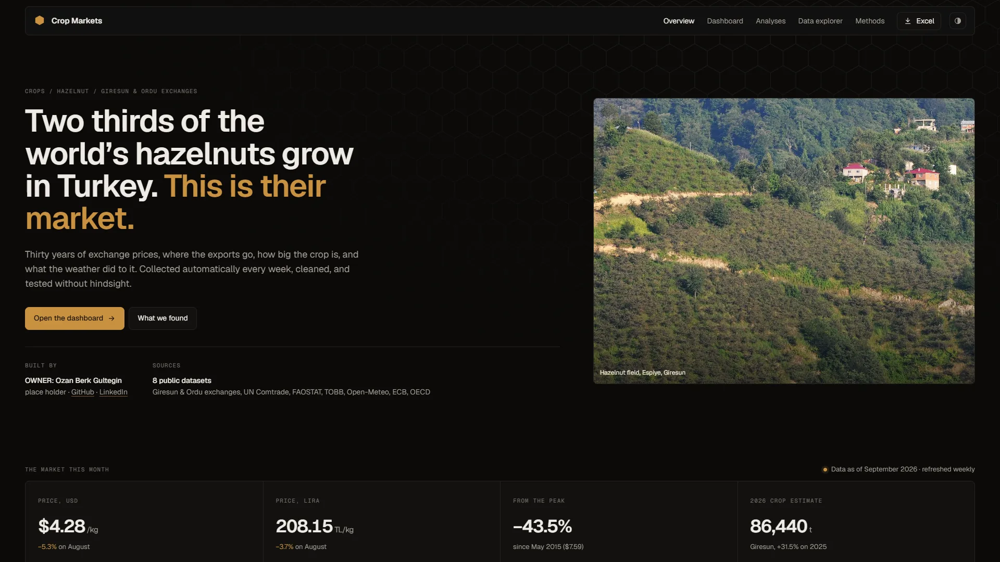

# Hazelnut Market Data

A data platform for the Turkish hazelnut market: daily prices, exchange rates, weather in the
growing regions, and production and export figures, collected every week and turned into
analysis, a public dashboard, an Excel workbook, and a tested price forecast.

Turkey grows roughly two thirds of the world's hazelnuts, and Ordu is the centre of it.
Traders, cooperatives and exporters make pricing and stocking decisions on exactly this data,
mostly from memory and WhatsApp groups.

**Site:** <https://imanurath.github.io/crop-markets/> (live once the first deploy from `main` has run).



## Status

Raw data is collected and explored (`notebooks/01_first_look.py`). The price forecasting
comparison is done: see [reports/forecast_results.md](reports/forecast_results.md). The site
(`site/`, Quarto) is built, with a weekly refresh-and-deploy workflow; it goes live when the
branch is merged to `main`.

## Parts

| Part      | What it does                                                    | State |
|-----------|-----------------------------------------------------------------|-------|
| Ingestion | Python jobs pulling prices, exchange rates, weather, production, exports | Done; runs weekly in GitHub Actions |
| Warehouse | PostgreSQL with raw, cleaned and reporting layers               | Not built yet; the pipeline uses CSV files |
| Analysis  | Answers to real questions about price movements                 | Done: notebooks and the site's analysis pages |
| Dashboard | Price trends, export destinations, crop size, forecast scores   | Done on the site (Plotly). Power BI: maybe later, as a template download |
| Excel     | Automated weekly workbook                                       | Done: full workbook, plus any filtered view from the data explorer |
| ML        | Price forecast with a baseline comparison and backtest          | Done: [results](reports/forecast_results.md) |

## What the site shows

- **Overview**: the market in numbers (price in USD and lira, distance from the peak, the crop
  estimate) and four ways in.
- **Dashboard**: price history in USD or lira (5y, 10y, all), where the USD price could be in
  6 months, export destinations, crop size against price, and the forecast scoreboard.
- **Analyses**: seasonality, export markets, crop and frost years, Giresun against Ordu, and
  forecasting. The honest result, that no model beats "next month's price = this month's
  price" in USD, is the centrepiece; holdout scores are labelled "scored once, never tuned on".
- **Data explorer**: every monthly record, filterable, with "Download this view (.xlsx)".
- **Methods**: a plain-language glossary and how each number is made, including the leak-free testing.
- **Downloads**: the full formatted workbook, with source credits.

The Turkish site is live under `/tr/`: every page in Turkish at the same paths (a switch in
the navbar, and a Turkish-first browser is sent there once), with a Turkish workbook
(`hazelnut-market-data-tr.xlsx`).

## Weekly refresh

`.github/workflows/refresh-site.yml` runs every Monday 05:00 UTC (and on demand):
`check_site_vars.py` (owner details filled in, `author_bio_tr` included; no `TODO` left in
`site/i18n/tr.yml`, since the workflow sets `SITE_DEPLOY=en,tr`) → fetch → `build_tables.py` →
`build_site_data.py` → `check_countries.py` (warns, never fails, about an export destination
without a Turkish name) → `build_workbook.py` (both workbooks) → `pytest tests/site
tests/test_fetch_raw.py` → `render_site.py` (English, then Turkish) → rendered-site tests
and link check over both trees → bot commit of `site/data/` to `main` → GitHub Pages deploy.
Forecast scores come from the committed `reports/backtest/` results; only the cheap
naive-empirical price range is recomputed each week.

When something fails:

- **One source fails** (even halfway): its raw folder is dropped, so a partial fetch is never
  published as fresh. Its outputs keep the last good files from the committed `site/data/`, are
  marked stale in the manifest, and show their own "as of" date. The run carries on. An output
  whose row count falls more than 10% below the last build counts as failed in the same way.
- **The core price series fails** (including such a row-count drop), or validation finds a
  problem (latest month too old, gaps, negative prices): `build_site_data.py` exits 1, nothing is committed or deployed,
  and the live site stays as it was.
- **Owner details, a Turkish `TODO`, workbook, tests, render or link test fail**: the same,
  no commit and no deploy.
- Failed sources, the per-output status / as-of table and any validation problems go to the
  run's Actions summary.

The bot commit lands every week (the manifest's build time always changes), which also keeps
GitHub from disabling the schedule after 60 idle days.

## Render the site locally

Needs Quarto CLI 1.11.9 and the venv with `requirements-site.txt` and `pip install -e .`
(details in [site/README.md](site/README.md)):

```bash
export QUARTO_PYTHON="$PWD/.venv/Scripts/python.exe"   # PowerShell: $env:QUARTO_PYTHON = "..."
./.venv/Scripts/python.exe scripts/build_site_data.py    # refresh site/data/ (needs data/interim)
./.venv/Scripts/python.exe scripts/build_workbook.py     # site/downloads/*.xlsx (English and -tr)
./.venv/Scripts/python.exe scripts/render_site.py        # English -> site/_site/, Turkish -> site/_site/tr/
./.venv/Scripts/python.exe scripts/render_site.py --lang tr   # Turkish only (keeps the English tree)
```

`render_site.py` runs `quarto` from PATH unless `QUARTO` names it. A plain `quarto render
site` renders English only and empties `site/_site/tr`. To look at the result, serve
`site/_site` under a `crop-markets/` folder (the site's path on Pages), for example with
`python -m http.server`.

## Adding a crop

Only the site layer takes the crop as a parameter; the fetch, table and forecast pipeline is
still hazelnut-only and gets refactored when a second crop is added.

1. **`site/crops.yml`**: an entry keyed by the slug, with every key set: `slug` (same as the
   key), `name`, `country`, `exchanges`, `sections`, `analyses`, `range_currencies` (currencies
   the range panel may show) and `local_currency: {label, column}`.
2. **Builders module** `src/hazelnut/site/<slug>_data.py`, defining:
   - `BUILDERS`: `{output name: (function(tables) -> DataFrame, needed table keys)}`.
     `prices_monthly` is core (`month`, `usd_kg` and the `local_currency.column`; the price
     range and stat strip read these, and the stat strip's local keys follow that column, e.g.
     `try_kg`/`try_mom`). An output whose tables are missing keeps its last good file, marked
     stale.
   - `INPUT_FILES`: `{table key: ("interim" or "manual", file name)}`, the tables the
     builders read; and `PRICE_COLUMNS`, the `prices_monthly` columns validation checks.
   - Optional: `STATS_CROP_COL` (the `crop_by_year` column shown as the crop estimate),
     `AS_OF` (`{output: function(tables) -> "as of"}` for outputs without a month or year
     column), `BACKTEST_DIR` (the crop's committed backtest results; without it the crop gets
     no forecasting tables and those panels show as unavailable) and `CROP_CHECK_METHODS`
     (`{backtest method: (method shown, crop-estimate source)}` for the crop-estimate check).
   - `WORKBOOK_SHEETS`, `WORKBOOK_SHEET_NOTES`, `WORKBOOK_SOURCES` (workbook, Downloads page,
     source count on the overview) and `EXPLORER_SHEETS` (which sheet each exchange shows).
     Their words (sheet names, headers, notes, source credits) are `<slug>.*` entries in
     `site/i18n/en.yml` and `tr.yml`, read through `hazelnut.site.i18n.t`.
   - Optional `HOLDOUT_PERIOD` and `TIMING_NOTE` for the Methods page.
   - In both `site/i18n/*.yml` files, `crop.<slug>.name` and `crop.<slug>.country` (the
     English ones match `crops.yml`; a test checks).
3. **Register it** in `CROP_MODULES` in `src/hazelnut/site/crops.py`.
4. **Pages**: copy `site/hazelnut/` to `site/<slug>/`, change each page's
   `load_crops()["hazelnut"]` and the explorer's two `FileAttachment` paths, and rewrite the
   crop-specific copy. Home, Methods and Downloads pick the crop up from `crops.yml`; the navbar
   in `site/_quarto.yml` is hazelnut-only for now.
5. **Data**: run `build_site_data.py --crop <slug>` and `build_workbook.py --crop <slug>`, and
   add the same two calls to the workflow (it runs the default crop only). The results tables
   come from the crop's own `BACKTEST_DIR` (hazelnut: `reports/backtest`); `--backtest <dir>`
   overrides it for one run.
