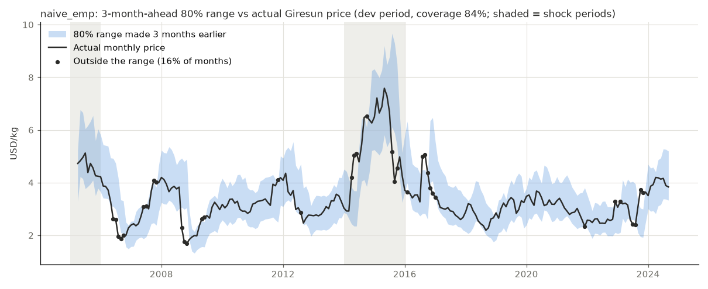

# Forecast ranges: findings

Dev period only (target months 2005-02 to 2024-09, about 233 per horizon); the holdout was not
touched. Each method gives the 5/10/50/90/95% quantiles of the price 1, 3 and 6 months ahead,
using only data up to the origin. Run with `scripts/run_intervals.py`.

- **naive_emp**: last price x exp(empirical quantiles of all past h-month log changes), expanding window.
- **naive_vol**: same, with each past change scaled by the trailing 12-month std of 1-month changes.
- **sarima**: the model's own (normal, log-price) prediction intervals.
- **chronos**: Chronos-Bolt native 10/50/90% quantiles; 5/95% extrapolated (it is not trained past 10/90).
- **lightgbm_q**: LightGBM quantile regression, one model per horizon and level, same features as `lightgbm`.

## Scores (horizons 1 / 3 / 6 months)

An honest 80% range covers about 0.80; 90% about 0.90. Width is the mean 80% range in USD/kg.
Skill = 1 - pinball loss / naive_emp pinball loss (averaged over the five quantiles; > 0 beats naive_emp).

| Method     | 80% coverage   | 80% width      | 90% coverage   | Pinball skill          | 80% cov., shocks |
|------------|----------------|----------------|----------------|------------------------|------------------|
| naive_emp  | .82 / .84 / .83 | 0.69 / 1.62 / 2.55 | .91 / .92 / .90 | 0 / 0 / 0           | .63 / .79 / .67 |
| naive_vol  | .79 / .79 / .80 | 0.74 / 1.60 / 2.63 | .88 / .88 / .90 | -.04 / -.07 / -.10  | .69 / .73 / .67 |
| sarima     | .87 / .85 / .84 | 0.88 / 1.78 / 2.63 | .91 / .91 / .90 | -.00 / -.03 / -.03  | .74 / .76 / .63 |
| chronos    | .83 / .83 / .78 | 0.85 / 1.48 / 2.15 | .90 / .86 / .85 | -.05 / -.06 / -.03  | .60 / .70 / .57 |
| lightgbm_q | .56 / .50 / .45 | 0.45 / 0.77 / 1.13 | .70 / .66 / .62 | -.10 / -.22 / -.24  | .40 / .36 / .23 |

Shock months (2005, 2014-15) are 30-35 per horizon. In calm months naive_emp's 80% range covers
.85 / .85 / .86 (slightly too wide); in shocks it covers .63 to .79 with ranges about 1.6x wider.
Block-bootstrap 90% intervals (12-month blocks) for the skill: sarima h=1 [-.05, +.03] (a tie);
every other method/horizon is below zero, except chronos h=6 [-.12, +.05] (a tie with a lower
90% coverage).

## Verdict

- **The naive-empirical range is the best range forecast at every horizon.** It is honest
  overall (80% covers 82-84%, 90% covers 90-92%) and has the lowest pinball loss. No method beats
  it, which matches the point-forecast result: the price is close to a random walk, and the
  spread of past h-month moves is all the information there is.
- **A usable rule of thumb** (naive_emp as of 2023-24): from today's price, the 80% range is
  about -8% / +11% at 1 month, -19% / +26% at 3 months and -29% / +40% at 6 months. It is
  skewed upwards, because big moves in this market have more often been spikes.
- **SARIMA** is as good at 1 month but wider than needed at 3 and 6 months. **Chronos** gives
  narrower 3- and 6-month ranges, but they undercover (90% covers 85-86%) and miss most in
  shocks. **Volatility scaling does not help**: shocks are not announced by the previous
  year's volatility (windows of 6, 24, 36 and 60 months were also worse). **LightGBM quantiles
  are badly overconfident** (an 80% range covers 45-56%), most likely because the trees fit
  the tails of the training data too closely.
- **Shocks remain the weak spot for every method**: 80% ranges cover only 57-79% of shock
  months. A range forecast cannot see a shock coming; it can only be wide enough.

Caveats: 3- and 6-month rows overlap, so they are far from independent (hence the bootstrap).
The 90% coverage rests on only about 23 misses per horizon. Chronos 5/95% quantiles are
extrapolated assuming a normal shape.
