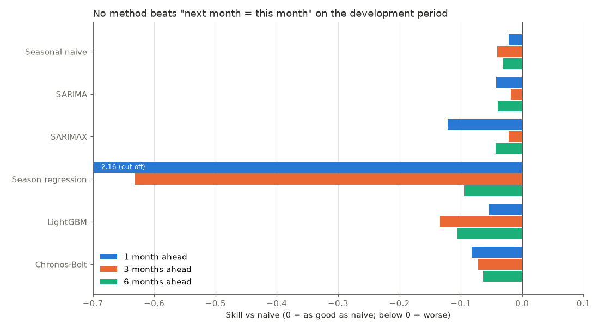
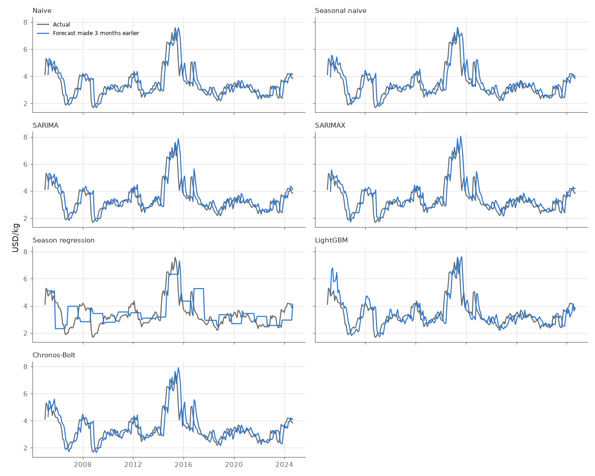

# Hazelnut price forecasting: results

Target: Giresun Commodity Exchange monthly average in-shell hazelnut price, USD/kg. Forecasts 1, 3 and 6 months ahead, from a walk-forward backtest where each forecast uses only information available at the time. Code: `src/hazelnut/forecast/`, runs: `scripts/run_backtest.py`, this report: `notebooks/02_forecast_comparison.py`.

## Summary (development period)

- **Nothing beats naive.** Over 236 monthly forecast origins (target months 2005-02 to 2024-09),
  no method improves on "next month's price = this month's price" at any horizon. The
  closest challengers (seasonal naive and SARIMA) lose to it by 2-4%.
  That is the honest headline: the Giresun USD price behaves close to a random walk at
  1-6 months.
- **Outside inputs did not help.** SARIMAX (with crop estimate and exchange-rate changes)
  is no better than SARIMA without them, and worse at 1 month. LightGBM with every input
  is worse than naive by 5-13%, and Chronos-Bolt (zero-shot, price only) by 6-8%.
- **Shocks are where everyone fails.** In the 2005 and 2014-15 shock periods, errors are
  2 to 2.7 times their calm-period size for every month-to-month method, naive included.
  (The season regression's errors grow less because they are already large in calm months.)
  Beating naive during shocks is rare and small: seasonal naive at 1 and 6 months (+2 to +4%)
  and the season regression at 6 months (+6%).
- **The season regression is a different tool.** Used as a monthly forecast it is far worse
  than naive (it predicts one season average for every month). At season level it beats
  "same as last season" (MAE 0.69 vs 0.93 USD/kg) but is about level
  with simply taking the August price (0.66), on only 19 seasons.

## Summary (final holdout, 2024-10 to 2026-09)

- **Only 24 forecasts per horizon**, half of them in the 2025 price spike, so one or two
  big misses move every number here. Read it as a sanity check, not a new ranking.
- **Still no consistent winner over naive.** Some methods edge ahead at one horizon:
  SARIMA (+5%) and LightGBM (+5%) at 1 month, the season regression (+18%) at 6 months.
  Each of them loses at another horizon (LightGBM by 22% at 6 months), and none of them
  beat naive on the development period.
- **The 6-month season-regression gain is small-sample luck as much as skill.** 42% of its
  6-month forecasts were naive fallbacks, and the gain comes from the calm months (late 2024
  and 2026), not the 2025 spike. At
  season level it again sits next to "take the August price" (2 seasons only).
- **The development-period conclusion stands.** At 1-6 months this price is very hard to beat
  with "it stays where it is". A model is worth using only if it beats naive on both periods,
  and none does.

## Scores, development period (target months 2005-02 to 2024-09)

MAE in USD/kg, MAPE in %, skill = 1 - MAE / naive MAE (above 0 beats naive), fallback = share of forecasts where the method declined and naive was used.

|                   |   MAE h=1 |   MAE h=3 |   MAE h=6 |   MAPE % h=1 |   MAPE % h=3 |   MAPE % h=6 |   Skill h=1 |   Skill h=3 |   Skill h=6 |   Fallback h=1 |   Fallback h=3 |   Fallback h=6 |
|:------------------|----------:|----------:|----------:|-------------:|-------------:|-------------:|------------:|------------:|------------:|---------------:|---------------:|---------------:|
| Naive             |     0.23  |     0.456 |     0.711 |          6.6 |         13.9 |         21.8 |       0     |       0     |       0     |              0 |           0    |           0    |
| Seasonal naive    |     0.235 |     0.474 |     0.733 |          6.9 |         14.5 |         22.8 |      -0.022 |      -0.041 |      -0.031 |              0 |           0    |           0    |
| SARIMA            |     0.24  |     0.465 |     0.74  |          6.9 |         14.2 |         22.8 |      -0.043 |      -0.019 |      -0.039 |              0 |           0    |           0    |
| SARIMAX           |     0.258 |     0.466 |     0.742 |          7.5 |         14.3 |         23.1 |      -0.122 |      -0.022 |      -0.043 |              0 |           0    |           0    |
| Season regression |     0.727 |     0.744 |     0.778 |         23.3 |         23.3 |         24   |      -2.159 |      -0.633 |      -0.094 |              0 |           0.17 |           0.42 |
| LightGBM          |     0.243 |     0.517 |     0.787 |          7   |         15.4 |         23.5 |      -0.054 |      -0.134 |      -0.106 |              0 |           0    |           0    |
| Chronos-Bolt      |     0.249 |     0.489 |     0.757 |          7.1 |         14.6 |         22.8 |      -0.082 |      -0.072 |      -0.064 |              0 |           0    |           0    |

## Calm vs shock periods

Shock periods by target month: 2005, 2014-2015, 2025.

|                        |   N calm |   N shock |   MAE calm |   MAE shock |   Skill calm |   Skill shock |
|:-----------------------|---------:|----------:|-----------:|------------:|-------------:|--------------:|
| Naive, h=1             |      201 |        35 |      0.19  |       0.464 |        0     |         0     |
| Naive, h=3             |      201 |        33 |      0.397 |       0.814 |        0     |         0     |
| Naive, h=6             |      201 |        30 |      0.617 |       1.346 |        0     |         0     |
| Seasonal naive, h=1    |      201 |        35 |      0.199 |       0.446 |       -0.048 |         0.039 |
| Seasonal naive, h=3    |      201 |        33 |      0.413 |       0.849 |       -0.04  |        -0.043 |
| Seasonal naive, h=6    |      201 |        30 |      0.647 |       1.314 |       -0.048 |         0.024 |
| SARIMA, h=1            |      201 |        35 |      0.201 |       0.466 |       -0.059 |        -0.004 |
| SARIMA, h=3            |      201 |        33 |      0.402 |       0.844 |       -0.013 |        -0.037 |
| SARIMA, h=6            |      201 |        30 |      0.635 |       1.437 |       -0.03  |        -0.068 |
| SARIMAX, h=1           |      201 |        35 |      0.217 |       0.496 |       -0.144 |        -0.07  |
| SARIMAX, h=3           |      201 |        33 |      0.406 |       0.833 |       -0.022 |        -0.024 |
| SARIMAX, h=6           |      201 |        30 |      0.643 |       1.41  |       -0.042 |        -0.047 |
| Season regression, h=1 |      201 |        35 |      0.719 |       0.772 |       -2.796 |        -0.665 |
| Season regression, h=3 |      201 |        33 |      0.715 |       0.925 |       -0.799 |        -0.137 |
| Season regression, h=6 |      201 |        30 |      0.705 |       1.268 |       -0.143 |         0.058 |
| LightGBM, h=1          |      201 |        35 |      0.202 |       0.478 |       -0.064 |        -0.03  |
| LightGBM, h=3          |      201 |        33 |      0.426 |       1.071 |       -0.073 |        -0.316 |
| LightGBM, h=6          |      201 |        30 |      0.643 |       1.749 |       -0.043 |        -0.299 |
| Chronos-Bolt, h=1      |      201 |        35 |      0.204 |       0.506 |       -0.078 |        -0.091 |
| Chronos-Bolt, h=3      |      201 |        33 |      0.417 |       0.93  |       -0.049 |        -0.143 |
| Chronos-Bolt, h=6      |      201 |        30 |      0.644 |       1.511 |       -0.044 |        -0.122 |

## Season-ahead regression, season level

One forecast per August for the average price of the coming September-August season. 19 seasons: a small sample.

|                       |   MAE |   MAPE % |
|:----------------------|------:|---------:|
| Season regression     | 0.688 |     21.9 |
| Last season's average | 0.933 |     27.1 |
| August price          | 0.655 |     19.5 |

|   season |   forecast |   actual |   naive_last_season |   naive_august |
|---------:|-----------:|---------:|--------------------:|---------------:|
|     2005 |      2.32  |    3.662 |               4.452 |          4.384 |
|     2006 |      3.974 |    2.475 |               3.662 |          1.963 |
|     2007 |      2.832 |    3.912 |               2.475 |          3.004 |
|     2008 |      3.436 |    2.21  |               3.912 |          3.829 |
|     2009 |      2.794 |    3.169 |               2.21  |          2.65  |
|     2010 |      3.552 |    3.138 |               3.169 |          2.984 |
|     2011 |      3.492 |    3.692 |               3.138 |          3.138 |
|     2012 |      3.1   |    2.834 |               3.692 |          2.857 |
|     2013 |      3.175 |    3.923 |               2.834 |          3.31  |
|     2014 |      6.332 |    6.636 |               3.923 |          5.436 |
|     2015 |      4.351 |    3.96  |               6.636 |          5.166 |
|     2016 |      5.278 |    3.464 |               3.96  |          4.994 |
|     2017 |      2.934 |    2.753 |               3.464 |          2.904 |
|     2018 |      3.352 |    2.889 |               2.753 |          2.367 |
|     2019 |      2.691 |    3.308 |               2.889 |          3.343 |
|     2020 |      3.44  |    3.11  |               3.308 |          3.129 |
|     2021 |      3.225 |    2.58  |               3.11  |          2.879 |
|     2022 |      2.559 |    2.864 |               2.58  |          2.448 |
|     2023 |      2.954 |    3.827 |               2.864 |          2.388 |

## 3-month-ahead forecasts vs actual

## Scores, final holdout (target months 2024-10 to 2026-09, scored once)

|                   |   MAE h=1 |   MAE h=3 |   MAE h=6 |   MAPE % h=1 |   MAPE % h=3 |   MAPE % h=6 |   Skill h=1 |   Skill h=3 |   Skill h=6 |   Fallback h=1 |   Fallback h=3 |   Fallback h=6 |
|:------------------|----------:|----------:|----------:|-------------:|-------------:|-------------:|------------:|------------:|------------:|---------------:|---------------:|---------------:|
| Naive             |     0.327 |     0.85  |     1.389 |          5.8 |         15   |         25   |       0     |       0     |       0     |              0 |           0    |           0    |
| Seasonal naive    |     0.337 |     0.904 |     1.432 |          6   |         16.1 |         26   |      -0.031 |      -0.063 |      -0.031 |              0 |           0    |           0    |
| SARIMA            |     0.311 |     0.864 |     1.404 |          5.5 |         15.4 |         25.5 |       0.047 |      -0.016 |      -0.011 |              0 |           0    |           0    |
| SARIMAX           |     0.342 |     0.861 |     1.402 |          6.1 |         15.3 |         25.6 |      -0.048 |      -0.013 |      -0.009 |              0 |           0    |           0    |
| Season regression |     1.007 |     0.977 |     1.144 |         17.2 |         16.7 |         19.9 |      -2.084 |      -0.148 |       0.176 |              0 |           0.17 |           0.42 |
| LightGBM          |     0.31  |     0.888 |     1.689 |          5.4 |         15.7 |         30.7 |       0.052 |      -0.044 |      -0.216 |              0 |           0    |           0    |
| Chronos-Bolt      |     0.374 |     0.849 |     1.378 |          6.5 |         14.9 |         24.7 |      -0.146 |       0.002 |       0.008 |              0 |           0    |           0    |

### Dev vs holdout

|                        |   Dev MAE |   Dev skill |   Holdout MAE |   Holdout skill |
|:-----------------------|----------:|------------:|--------------:|----------------:|
| Naive, h=1             |     0.23  |       0     |         0.327 |           0     |
| Naive, h=3             |     0.456 |       0     |         0.85  |           0     |
| Naive, h=6             |     0.711 |       0     |         1.389 |           0     |
| Seasonal naive, h=1    |     0.235 |      -0.022 |         0.337 |          -0.031 |
| Seasonal naive, h=3    |     0.474 |      -0.041 |         0.904 |          -0.063 |
| Seasonal naive, h=6    |     0.733 |      -0.031 |         1.432 |          -0.031 |
| SARIMA, h=1            |     0.24  |      -0.043 |         0.311 |           0.047 |
| SARIMA, h=3            |     0.465 |      -0.019 |         0.864 |          -0.016 |
| SARIMA, h=6            |     0.74  |      -0.039 |         1.404 |          -0.011 |
| SARIMAX, h=1           |     0.258 |      -0.122 |         0.342 |          -0.048 |
| SARIMAX, h=3           |     0.466 |      -0.022 |         0.861 |          -0.013 |
| SARIMAX, h=6           |     0.742 |      -0.043 |         1.402 |          -0.009 |
| Season regression, h=1 |     0.727 |      -2.159 |         1.007 |          -2.084 |
| Season regression, h=3 |     0.744 |      -0.633 |         0.977 |          -0.148 |
| Season regression, h=6 |     0.778 |      -0.094 |         1.144 |           0.176 |
| LightGBM, h=1          |     0.243 |      -0.054 |         0.31  |           0.052 |
| LightGBM, h=3          |     0.517 |      -0.134 |         0.888 |          -0.044 |
| LightGBM, h=6          |     0.787 |      -0.106 |         1.689 |          -0.216 |
| Chronos-Bolt, h=1      |     0.249 |      -0.082 |         0.374 |          -0.146 |
| Chronos-Bolt, h=3      |     0.489 |      -0.072 |         0.849 |           0.002 |
| Chronos-Bolt, h=6      |     0.757 |      -0.064 |         1.378 |           0.008 |

## Method notes

- **Naive**: last observed price. **Seasonal naive**: last price times the average past change between this calendar month and the target month.
- **SARIMA / SARIMAX**: seasonal ARIMA on log price with drift; order picked by AIC on training data once a year; SARIMAX adds crop-estimate change and USD/TRY change.
- **Season regression**: each August, log change of the season average regressed on the log change of the Giresun crop estimate.
- **LightGBM**: one model per horizon on price lags, month, crop, frost, exports, FX and volume features; fixed parameters, refit every month.
- **Chronos-Bolt (small)**: pretrained forecaster, zero-shot on the price history only.
