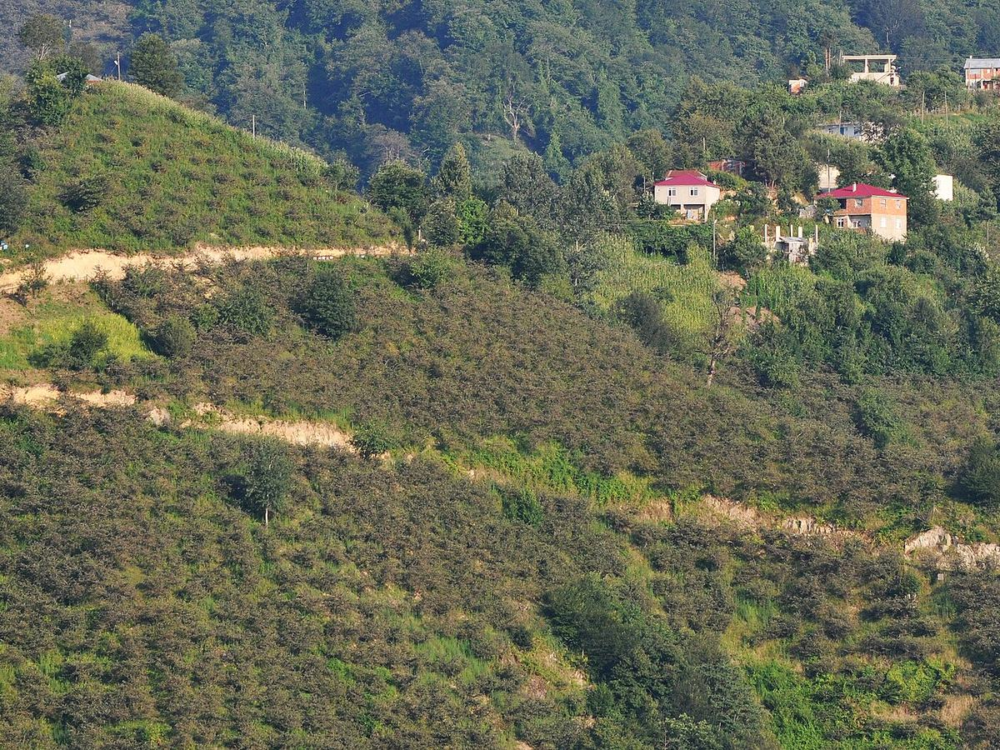

```{python}
from hazelnut.site import page_helpers as ph
from hazelnut.site.config import SITE_DIR, load_crops

crop = load_crops()["hazelnut"]
stats, manifest = ph.load_page_data(SITE_DIR / "data" / crop.slug)
eyebrow = f"Crops / {crop.name} / {ph.exchanges_phrase(crop.exchanges)}"
```

::: {.hero}
::: {}
[`{python} eyebrow`]{.eyebrow}

# Two thirds of the world's hazelnuts grow in Turkey. *This is their market.*

::: {.lede}
Thirty years of exchange prices, where the exports go, how big the crop is, and what the weather did to it. Collected automatically every week, cleaned, and tested without hindsight.
:::

::: {.btns}
[Open the dashboard <svg class="ico" aria-hidden="true"><use href="#arrow-right"/></svg>](dashboard.qmd){.btn .pri}
[What we found](analyses/index.qmd){.btn}
:::

::: {.byline}
::: {}
[Built by]{.eyebrow} ****  · [GitHub]() · [LinkedIn]()
:::

::: {}
[Sources]{.eyebrow} **8 public datasets** Commodity exchanges, TOBB, UN Comtrade, FAOSTAT, weather
:::
:::
:::

```{=html}
<figure class="photo">
  
  <figcaption>Hazelnut field, Espiye, Giresun</figcaption>
</figure>
```
:::

```{python}
ph.raw_html(
    ph.market_meta_html(manifest)
    + ph.market_strip_html(
        stats, local_name="lira", local_unit=crop.local_currency.label, crop_source="Giresun"
    )
)
```

```{=html}
<div class="sect"><div><span class="eyebrow">Explore</span><h2>Four ways into the data</h2></div></div>
<nav class="explore" aria-label="Explore the data">
  <a href="dashboard.qmd"><h3>Dashboard <svg class="ico" aria-hidden="true"><use href="#arrow-right"/></svg></h3><p>Price, exports, crop and the forecast range, all on one page.</p></a>
  <a href="analyses/index.qmd"><h3>Analyses <svg class="ico" aria-hidden="true"><use href="#arrow-right"/></svg></h3><p>Seasons, export markets, frost years, Giresun against Ordu.</p></a>
  <a href="explorer.qmd"><h3>Data explorer <svg class="ico" aria-hidden="true"><use href="#arrow-right"/></svg></h3><p>Every monthly record. Filter it, then take it with you in Excel.</p></a>
  <a href="../methods.qmd"><h3>Methods <svg class="ico" aria-hidden="true"><use href="#arrow-right"/></svg></h3><p>How each number is made, in plain words, with no jargon left unexplained.</p></a>
</nav>
```
